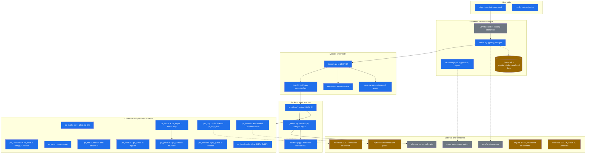

# Architecture

pyscriptc compiles one annotated Python file into a native binary. The pipeline is the same shape as [scriptc](https://github.com/vercel-labs/scriptc): a checker, a typed intermediate representation, then LLVM. The IR is Python's, not scriptc's. Parsing uses the CPython that is running the compiler. [mypy](https://mypy-lang.org/) is a preflight. Its tree is thrown away.

The goal is to track CPython instead of inventing a dialect that drifts. Unknown syntax, an unknown import, and an integer that does not fit the backend are fences. A newer CPython can parse a file the subset does not lower yet, and the compiler stops with a named reason instead of guessing. The IR is stamped with `sys.version`. LLVM emission refuses a stamp from a different interpreter.

The program that can ship today is a short script: annotated functions over `int`, `float`, `bool`, `str`, `bytes`, `list`, `dict`, `set` of `int` or `str`, and a class with a single base, plus the closed standard-library surface in `pyscriptc.stdlib_queue`. End-user scripts that fit live in [`examples/`](examples/README.md). How to run them is in the [documentation site](docs/getting-started/index.md). Contributor notes are in [`.agents/docs/`](.agents/docs/README.md).

## Pipeline

```
source.py
  CPython ast
  mypy preflight          (discarded; annotations on the AST are what lowering reads)
  lower.py                JSON IR, subset gates-v1, stamped with sys.version
  emit/llvm/              textual LLVM
  clang -O2               runtime/*.c linked beside the IR
  binary                  --call prints the function's return value
```

`pyscriptc compile FILE` writes the IR next to the LLVM text. `--emit ir` stops after the JSON file. `--emit llvm` stops after the `.ll` file. `--emit bin` and `--run` ask clang for a binary. `--run` also executes it. `--call` names the function the generated `main` calls. `--args` is a Python list literal parsed with `ast.literal_eval`.

Exit codes: `0` success, `1` a broken IR or a missing source, `2` the checker failed, `3` the file hit a fence, `4` the IR stamp or an integer does not fit this backend, `128+signal` when the binary dies on a signal.

## What the binary contains

Two link lines exist.

A file whose LLVM text has no `ps_island_` symbol links the small C runtime in `src/pyscriptc/runtime/` and `libm`. It does not link libpython. The baseline scripts in that shape sit near a few megabytes of RSS.

A file that calls `subprocess.check_output`, `socket.gethostname`, `threading.active_count`, `threading.current_thread().name`, `inspect.cleandoc`, or `logging.info` / `logging.warning` emits `ps_island_*`. The link line then adds `ps_island.c` and `-lpython3.14` from the interpreter that compiled the file, with an rpath to that library. The first island call runs `Py_InitializeEx(0)`. Constants such as `sys.platform`, `socket.AF_INET`, `ssl.OPENSSL_VERSION`, and `ctypes.sizeof` are baked at compile time and do not pull in libpython.

`sys.exit` is libc `exit`, not an island call.

## IR

`src/pyscriptc/ir.py` checks the JSON before emission. Version is `1`. The subset stamp is `gates-v1`. An `int` is a decimal string so JSON cannot round it. Float literals later become raw IEEE bits because the textual IR has to survive clang. JavaScript kinds from scriptc (`f64`, `nullT`, and the rest of `FORBIDDEN_KINDS`) are rejected.

Types come from annotations on the AST. mypy does not supply them. A name is annotated before it is used. A function that can fall off the end is a fence when the return type is not `None`.

The LLVM backend stores an `int` in `i64` when the value fits. Overflow uses `llvm.*.with.overflow` and traps. A literal that does not fit is `PS3002` at emission time. Floor division is Python floor division. Division by zero and `INT64_MIN / -1` trap.

## Where a fence is born

`src/pyscriptc/lower.py` lowers the language: statements, expressions, classes, calls, and the codec modules (`re`, `json`, `urllib.parse`, `base64`, `hashlib`, `struct`). `src/pyscriptc/restlower.py` lowers the rest of the queued standard library and the builtin helpers (`abs`, `min`, `sorted`, `open`, and the rest). `src/pyscriptc/stdlib_queue.py` is the closed import table. A module outside that table is `PS2002` at the import. `src/pyscriptc/builtins.py` is the method table for `str` and `bytes`.

The lowered standard library is a closed surface inside each module, not the whole module. `functools.reduce` lowers. `functools.partial` does not. The generated list is [`.agents/docs/support/supported.md`](.agents/docs/support/supported.md), and the user-facing summary is the [support model](docs/guide/support-model.md). The file map for changing it is [`.agents/docs/map.md`](.agents/docs/map.md). The language order after this queue is [`.agents/docs/roadmap.md`](.agents/docs/roadmap.md).

## Native libraries

A third-party `.so` from a wheel exports `PyInit_<module>`. That symbol builds a module of Python objects. The small runtime cannot call it. Two shapes work:

- **C ABI.** The library exports ordinary functions (`mix_crc32`, or the same symbols from a Rust `cdylib`). `ps_mix.c` loads that file with `dlopen`. The binary does not link libpython. This is what "link the native dependency" means.
- **Extension module.** `ps_island_mix_crc32` asks embedded CPython to `import` the extension, the same way `subprocess.check_output` already runs on the island. The binary links libpython. This is the only path for cryptography, numpy, pydantic-core, and the other `PyInit_*` wheels.

`import nativeprobe` lowers only through the benchmark's FFI manifest: `pyscriptc compile demo.py --ffi benchmarks/native/nativeprobe.toml` (issue #218). It is the probe behind [`benchmarks/native/`](benchmarks/native/README.md), not a supported module. A compile without the manifest still refuses it with `PS2002`.

## The emitter golden corpus

The LLVM emitter is a single large module, so it is tested per IR node kind rather than only through a whole compile. `src/pyscriptc/emitter.py` is the seam: `emit_ir_text` validates one IR module the way a compile does and renders it to LLVM text in memory, with no file, no subprocess and no toolchain.

`tests/fixtures/backend/llvm/` holds one fixture pair per node kind, plus a fixture per emitter dispatch branch (const type, binary op family, compare family, callee kind, try and raise shape): `<name>.ir.json` is the IR module the emitter sees, `<name>.ll` is the byte-exact text it must produce. `tests/fixtures/backend/manifest.json` records which IR node kind and which dispatch branch each fixture covers, and `tests/test_emitter_goldens.py` fails with the missing kinds or branches listed if the corpus stops covering the emitter's dispatch surface. The determinism test re-runs the generator in a scratch directory and asserts the corpus rebuilds byte-identically, so a golden diff is always a reviewed emitter change, never hash-order noise.

After an intentional emitter change, re-bless the corpus and review the diff:

```bash
uv run pytest tests/test_emitter_goldens.py --update-goldens
```

The fixture layout is backend-neutral: the IR input lives beside the LLVM expectation, so a second backend adds its own expectations beside the same inputs. The specification both emitters share, one IR and one runtime ABI, is the backend contract in [`.agents/docs/design/backend-contract.md`](.agents/docs/design/backend-contract.md).

## What this is for

The distribution story is one command:

```bash
mise run compile examples/access_log.py --run --call admit --args '["{\"method\":\"GET\",\"path\":\"/api/health\",\"status\":\"200\"}"]' -o /tmp/admit
```

The binary prints the return value. There is no `print` in the subset. Scripts whose work is integer cents, a JSON record, a date, a URL, a digest, or a path label fit. Keywords, stored defaults, same-type `and`/`or`, Latin-1 strings, step-1 slices, plain f-strings, `with open(...) as f`, and tuples of two or more fields lower. Tuple equality stays a fence. A directory compile resolves relative imports of functions, module-level constants, and classes the defining module emits, including a subclass of an exported class. `__main__.py` is skipped; the compile says it is the `python -m` script, not an importable module. A class or function that does not lower reports that definition's fence ahead of "is not exported". A module-level `if sys.version_info` compared with a tuple of ints keeps the taken branch. `global` of a module `None` slot, and `as_file(...).__enter__`, lower without libpython. A class may have one base. `@property`, `@staticmethod`, `@classmethod`, a flat `@dataclass`, and an integer `enum` lower. `super()`, multiple inheritance, and any other decorator stay fences. That boundary is written down in [`benchmarks/adoption/README.md`](benchmarks/adoption/README.md).

## Component inventory

This section inventories every component the project owns, vendors, or delegates to a tool, so we can see which owned components a maintained third-party library could replace. Line counts are `wc -l` of the source on master (2026-10-29); branch-only files are marked. "Owned" means we wrote and maintain it, "generated" means our script regenerates it from upstream data, "vendored" means third-party source we ship, "delegated" means an external tool does the work at build or compile time.

### Layers



### Compiler pipeline (Python, `src/pyscriptc/`)

| Component | Lines | Purpose | Owned/vendored/delegated | Callers | Platforms | Test pointers | Maintenance risk | Existing library candidate |
|---|---|---|---|---|---|---|---|---|
| cli.py | 2356 | `pyscriptc` command surface | owned | users, packaging/entry.py | all | tests/test_cli*, test_assess | flag surface grows with features | none |
| check.py | 521 | checker preflight | delegated to pyrefly (mypy/pyright legacy) | cli compile | all | tests/test_check* | pins a fast-moving checker | n/a (already delegated) |
| factsbridge.py | 773 | mypy inferred-type map to lowering, opt-in | delegated to mypy | lower/ | all | tests/test_factsbridge* | mypy API drift | n/a |
| typefacts.py | 1594 | checker-facts seam into lowering | owned | lower/ | all | tests/test_typefacts* | tracks checker output shape | none |
| lower/ (9 files) | 14388 | ast to JSON IR, subset fences | owned | cli, package.py | all | tests/test_lower*, fences | largest owned surface; tracks CPython grammar | none (CPython ast is the input) |
| restlower/ (~30 files) | 6470 | per-module stdlib lowering | owned | lower/_stdlib.py | all | tests/test_stdlib_* | grows with stdlib queue | none |
| coro.py | 2222 | generators and async def to frames | owned | lower/ | all | tests/test_coro_* | closure/frame semantics | none |
| ir.py, irverify.py, canonical.py | 1066 | JSON IR schema, verify, stable hash | owned | emit/, benchmarks | all | tests/test_canonical, ir-hashes.yml | low | none |
| emit/llvm/ (11 files) | 4391 | textual LLVM IR emission | owned | _driver.py | all | tests/test_emitter_goldens.py golden corpus | ABI and LLVM text drift | none (LLVM is the target) |
| emit/llvm/_driver.py | 521 | compile and link via clang or zig cc | delegated to clang/zig | cli | linux, macOS, Windows, wasi | tests/test_ffi_link, zig smoke | toolchain discovery | n/a |
| emitlib.py | 311 | static-library build | owned, shells to cc | cli | all | tests/test_emitlib* | low | n/a |
| sectiongc.py | 82 | -ffunction-sections link GC | owned (on branch work/netnative-tls, not yet on master) | _driver.py | all | tests/test_section_gc.py (branch) | low | n/a (linker flags) |
| package.py, imports.py, deps.py, sitedeps.py | 3341 | directory compile, import lanes, PyPI deps | owned | cli | all | tests/test_deps, test_imports* | PyPI metadata drift | none |
| ffi_manifest.py | 1071 | typed extern manifest parser | owned | adapters, benchmarks/native | all | tests/test_ffi* | low | none |
| assess.py, coverage.py, reduce.py | 2239 | assess, fence coverage, reducer | owned | cli | all | tests/test_assess, test_coverage, test_case_reducer | low | none |
| config.py, project.py | 744 | PEP 723 + [tool.pyscriptc], project scripts | owned | cli | all | tests/test_config* | low | none |
| stubs.py, sigregistry.py, builtins.py, stdlib_queue.py | 1554 | stub loading, signature registry, closed tables | owned | lower/, check.py | all | tests/test_stubs* | tracks typeshed | none |
| embed.py, stdlibzip.py, rtcache.py, runcache.py | 1237 | runtime pack fetch/cache, stdlib zip, caches | owned | cli, island | linux, macOS | tests/test_embed* | PBS release cadence | n/a |
| boxed.py | 476 | boxed fallback planner (island floor) | owned | lower/ | all | boxed ledger, tests | isolated, deletable | none |
| binding.py, dwarf.py, reflection.py, mobile.py, wasm_adapter.py | 1149 | ctypes bindings, DWARF, reflection, mobile, WASI adapter | owned (wasm_adapter wraps a pinned WASI blob) | cli, emit | all + mobile + wasi | tests/test_binding, zig/wasm smoke | DWARF and mobile triples | none |
| verify.py, diagnostics.py, telemetry.py, log.py, debug.py, doctor.py | 1868 | verify, PSxxxx codes, telemetry, audit log, debug mode, doctor | owned | cli | all | tests/test_diagnostics* | telemetry policy | none |
| zigshim.py | 157 | locate/install zig shim | owned wrapper around ziglang wheel | _driver.py | all | tests/test_zigshim* | ziglang wheel layout | n/a |
| _typeshed/ | 5.0 MB data | typeshed stdlib stubs | vendored (typeshed, Apache-2.0) | check.py, stubs.py | all | via checker tests | version bumps | n/a (upstream typeshed) |
| _pyright_stubs/ | 68 KB data | stub overrides for divergences | owned | check.py | all | via checker tests | drift vs typeshed | none |

### C runtime (`src/pyscriptc/runtime/`, ~28,000 lines C)

| Component | Lines | Purpose | Owned/vendored | Python feature | Platforms | Test pointers | Maintenance risk | Existing library candidate |
|---|---|---|---|---|---|---|---|---|
| ps_rt.c + ps_rt.h | 3417 | core runtime: alloc, exceptions, seq/map, FNV-1a string hash, f64 str via snprintf loop; explicitly no refcount, no GC | owned | everything | all | every compile test | memory model and float printing are subtle | float printing: Ryu (Apache-2.0/Boost, C, maintained: verified) or dragonbox (Apache-2.0, C++: verified); trade-off: one-file C drop-in vs C++ dependency, both replace libc-dependent snprintf loop |
| ps_unicode.c | 1871 | Latin-1 Unicode properties, str repr escapes | owned (tables from CPython 3.14 unicodedata) | str methods, unicodedata | all | tests/test_str*, unicode probes | Unicode version bumps; full tables gated (S4) | utf8proc (MIT, Unicode 18, C, maintained: verified) or ICU (Unicode license, C/C++, maintained: verified); trade-off: utf8proc is UTF-8-centric so our Latin-1/UTF-32-ish ops need shims, ICU is heavy |
| ps_case.c | 1982 | case-mapping tables, Unicode 16.0.0 | generated by scripts/gen_case_tables.py from CPython 3.14 str | str upper/lower/casefold | all | generator self-test, str tests | regeneration per Unicode release | utf8proc casefold (verified above); trade-off: same as ps_unicode |
| ps_re.c | 1356 | backtracking regex engine, subset of re | owned | re | all | tests/test_re_* (~10 files) | regex correctness and catastrophic backtracking | PCRE2 (BSD-3-Clause, C, maintained, 5-yr support policy: verified) or RE2 (BSD-3, C++: unverified) or oniguruma (BSD-2, C: unverified); trade-off: PCRE2 semantics differ from CPython re in edge cases, so the fence set moves rather than disappears |
| ps_fmt.c | 1107 | %-interpolation and str.format engine | owned | str.format | all | tests/test_basic_format, test_format_specs | format-spec mini-language | none (CPython-specific semantics); float part could use Ryu |
| ps_hash.c | 656 | MD5/SHA-1/SHA-2 with SHA-NI and NEON paths | owned | hashlib | x86_64, AArch64, Apple | tests/test_sha_dispatch | crypto primitive maintenance, HW dispatch | OpenSSL/libcrypto (Apache-2.0, maintained: verified) or mbedTLS (already vendored on branch); trade-off: adds a crypto dependency to every binary vs owning 656 lines |
| ps_hmac.c | 120 | HMAC over ps_hash digests | owned | hmac | all | tests/test_hmac* | low | same as ps_hash |
| ps_json.c | 683 | json.loads/dumps for the typed subset | owned | json | all | tests/test_r28_json, orjson pack conformance | float round-trip edge cases | yyjson (MIT, C89, one .c/.h, maintained: verified) or simdjson (Apache-2.0/MIT, C++, maintained: verified); trade-off: both parse to their own DOM, so a translation layer to PsSeq/PsMap stays |
| ps_yaml.c | 1006 | yaml.safe_load subset, re-emits JSON | owned | yaml | all | tests/test_yaml | YAML spec edge cases | libyaml (MIT, C, maintained: unverified); trade-off: libyaml is an event parser, the subset-to-JSON layer stays |
| ps_toml.c | 791 | tomllib.loads, TOML 1.0, re-emits JSON | owned | tomllib | all | tests/test_tomllib | TOML spec compliance | tomlc99/tomlc17 (MIT, C: unverified); trade-off: same DOM-translation caveat |
| ps_dt.c + ps_dtparse.c | 943 | date/time/datetime/timedelta, strptime subset; no tz database | owned | datetime | all | tests/test_stdlib_datetime | calendar math; tz would multiply it | none small and C; Howard Hinnant date (MIT, C++: unverified); trade-off: C++ dependency for a currently naive-only surface |
| ps_loop.c | 851 | single-threaded event loop behind asyncio.run | owned | asyncio | all (timer/self-pipe based) | tests/test_coro_async* | event-loop semantics vs CPython asyncio | libuv (MIT, C, epoll/kqueue/IOCP, maintained: verified) or libxev (MIT, C/Zig: unverified) or libev (GPL-2/BSD dual: unverified); trade-off: libuv pulls in a threadpool and its own handle model, heavier than our 851-line loop |
| ps_poller.c + ps_poller.h | 716 | fd poller: kqueue, epoll, poll fallback, counted interests | owned (on branch work/netnative-tls, not yet on master) | asyncio, selectors | macOS/BSD kqueue, Linux epoll, poll elsewhere | tests/test_poller_host.py (branch) | per-OS readiness semantics | libuv/libxev as above; trade-off: same |
| ps_select.c | 295 | selectors substrate over the poller | owned (on branch work/netnative-tls, not yet on master) | selectors | same as poller | branch tests | low once poller exists | same as poller |
| ps_async.c | 552 | asyncio Lock/Event/Semaphore/Queue, to_thread | owned | asyncio | pthread | tests/test_coro_asyncio_sync | synchronization correctness | none small; libuv has primitives but not asyncio semantics |
| ps_thread.c | 633 | threading Lock/RLock/ident/current | owned | threading | pthread, Windows | tests/test_threading_* | per-OS thread primitives | none (thin over pthread/Win32 already) |
| ps_queue.c | 327 | queue.Queue on pthreads | owned | queue | pthread | tests/test_queue* | low | none |
| ps_http.c | 822 | urllib.request subset over blocking BSD sockets | owned | urllib.request | all incl. Windows, wasi-limited | tests/test_http*, net receipt | socket portability | libcurl (MIT-like, C, maintained: unverified); trade-off: curl is a large dependency for a deliberately small subset |
| ps_http_tls.h + ps_ffi_http_tls.c | 491 | TLS seam + mbedTLS client adapter | owned seam, vendored mbedTLS 3.6.7 (Apache-2.0 OR GPL-2.0-or-later; on branch work/netnative-tls, not yet on master) | HTTPS | all | tests/test_https_tls.py (branch) | TLS is the classic do-not-own domain; already delegated | n/a (already delegated to vendored mbedTLS; OpenSSL 3.x alternative, Apache-2.0: verified) |
| ps_island.c | 1609 | embedded CPython island for the fallback tier | owned | ctypes, subprocess island, etc. | all, links libpython | boxed ledger, island tests | GIL handling, CPython ABI per micro | n/a (this IS the delegation) |
| ps_path.c | 1433 | posixpath, os, stat, fnmatch, pathlib | owned | os.path, pathlib | all incl. Windows | tests/test_pathlib*, ospath | Windows path semantics | none |
| ps_osmore.c | 1031 | importlib.resources, tempfile, shutil | owned | tempfile, shutil | all incl. wasi stub | tests | low | none |
| ps_more.c | 1116 | list/dict/str method cores, scalar casts | owned | builtins | all | broad | low | none |
| ps_argparse.c | 377 | argparse subset | owned | argparse | all | tests/test_argparse* | low | none |
| ps_dotenv.c | 455 | .env parsing | owned | dotenv | all | tests | low | none |
| ps_jwt.c | 429 | HS256/384/512 JWT subset | owned | jwt pack | all | tests/test_jwt* | crypto-adjacent | none small |
| ps_io.c | 396 | StringIO, BytesIO, open, NamedTemporaryFile | owned | io, open | all | tests/test_io* | low | none |
| ps_sub.c | 554 | subprocess run/call subset | owned | subprocess | all incl. Windows | tests | fork/exec portability | none small |
| ps_help.c | 575 | abs/sum (Neumaier) and other builtin helpers | owned | builtins | all | tests | float summation details | none |
| ps_wrap.c | 522 | textwrap port of CPython 3.13 | owned (port of CPython, PSF-licensed algorithm) | textwrap | all | tests | tracks CPython textwrap | none |
| ps_url.c | 327 | quote/unquote subset | owned | urllib.parse | all | tests | low | none |
| ps_coll.c | 191 | collections.deque | owned | collections | all | tests | low | none |
| ps_csv.c | 174 | csv excel-dialect reader/writer | owned | csv | all | tests | low | none |
| ps_b64.c | 168 | base64 | owned | base64 | all | tests | low | none |
| ps_struct.c | 291 | struct.pack/unpack | owned | struct | all | tests | low | none |
| ps_rand.c | 244 | MT19937 random | owned | random | pthread | tests | must match CPython seeding | none |
| ps_time.c | 247 | time/gmtime/localtime/strftime | owned | time | all | tests | low | none |
| ps_log.c | 87 | logging subset | owned | logging | all | tests | low | none |
| ps_osfd.c, ps_compat.c/h, ps_copy.c, ps_mix.c, ps_init.c, ps_argv.c | 640 | fd ops, platform shims, copy, dlopen seam, init, argv | owned | os, copy, FFI seam | all incl. Windows, wasi | tests | low | none |
| wasm/rt_wasm.c | 110 | WASI setjmp/longjmp EH runtime | vendored (WebAssembly/wasi-libc) | wasm EH | wasi only | zig/wasm smoke | low | n/a (already vendored upstream) |

### Adapters, vendored third-party, build and release

| Component | Lines/size | Purpose | Owned/vendored/delegated | Platforms | Maintenance risk | Existing library candidate |
|---|---|---|---|---|---|---|
| packaging/adapters/pyscriptc-orjson | ~200 | orjson pack: thunks over ps_json.c, no vendored C | owned | macOS-arm64, linux-musl | low | n/a |
| packaging/adapters/pyscriptc-sqlite | ~300 + fetch | FFI pilot; fetch_vendor.py pins SQLite 3.54.1 amalgamation (public domain, sha-verified, not committed) | owned seam, vendored SQLite | all | pin bumps | n/a (already vendored upstream) |
| packaging/adapters/pyscriptc-http | ~500 + 4446-line client mbedTLS config | HTTPS adapter; fetch_vendor.py pins mbedTLS 3.6.7 (Apache-2.0 OR GPL-2.0-or-later, sha-verified, not committed) | owned seam, vendored mbedTLS (on branch work/netnative-tls, not yet on master) | all | TLS pin bumps | n/a |
| packaging/build.sh, entry.py, smoke.sh | ~310 | Nuitka onefile release binary | owned, delegated to Nuitka | linux, macOS, Windows | Nuitka onefile quirks (mypy excluded) | n/a |
| packaging/runtime.lock.toml + third-party.toml + pbs_licenses.toml | data | pin PBS CPython 3.14.9 packs; inventory expat 2.7.3, libffi 3.5.2, mpdecimal 2.5.1, OpenSSL 3.5.4, SQLite 3.51.0, zlib 1.3.1, zstd 1.5.7, ncurses 6.5 inside libpython | vendored (PBS assets, sha256-pinned) | linux-x86_64, macos-arm64 | CPython micro bumps (runtime-bump.yml weekly) | n/a |
| src/pyscriptc/pbs_licenses/ | 21 files | license texts for the above | vendored texts | n/a | low | n/a |
| scripts/*.py (18 tools) | ~110 KB | doc/table generators, compat.json builder, runtime pack builder, emitter golden generator | owned | dev host | generator drift vs sources | none |
| benchmarks/ (excl. compat2 corpus) | ~290 KB py | scorer v1 (frozen), v2 harness, perf receipts, adoption ladders | owned | dev host | oracle CPython version pins | none |
| compat site (apps/web + data/compat) | ~860 KB | Astro site, compat.json/support.json/ladder.json | owned, delegated to Astro | web | Astro/npm churn | n/a |
| .github/workflows (8) | yaml | ci, release, cut-release, nightly, site, embed, ir-hashes, runtime-bump | owned | CI | GitHub Actions drift | n/a |
| docker/ | 3 files | dev image with pinned CPython oracles | owned | linux | low | n/a |

### Notes on the tricky domains

- Unicode: ps_unicode.c is Latin-1 only by design; ps_case.c is full-range generated tables. Both regenerate from the CPython 3.14 oracle, so the maintenance cost is the generator, not hand-written tables.
- Regex: ps_re.c is a from-scratch backtracking engine; it is the single largest owned correctness surface in the runtime after the lowerer.
- Float printing: ps_rt.c ps_f64_str is a shortest-round-trip search over libc snprintf with strtod verification, not Ryu/Grisu; results depend on libc quality.
- Bigint: there is no owned bigint; ints are i64 with overflow traps (PS3002), and bigint falls to the boxed/island tier (tests/test_fallback_bigint.py). If a native bigint is ever wanted, libtommath (public domain/Unlicense, C, maintained: verified) or GMP (LGPL-3/GPL-2 dual, C: unverified) or mpdecimal (BSD-2, already inside the PBS pack: verified) are the candidates.
- Hashing: container hashing is FNV-1a plus a splitmix64 finalizer inside ps_rt.c, not SipHash; DoS resistance differs from CPython. siphash (reference impl, CC0/public domain: unverified) or xxHash (BSD-2, C, maintained: verified) are candidates if that ever matters.
- GC/memory: the runtime has no refcounts and no GC by design (arena/free-list plus exit registry). Boehm bdwgc (MIT-style, C, maintained: verified) is the standard candidate if GC is ever wanted; trade-off: conservative collection changes the whole allocation contract.
- TLS: already delegated to vendored, pinned mbedTLS on the netnative-tls branch; on master there is no owned TLS.
- Event loop: ps_loop.c plus the branch poller/select are owned; libuv is the obvious maintained candidate but is much heavier than the current 1700-line stack.
- Date/time: naive arithmetic only, no IANA tz database; the risk arrives with zoneinfo, which does not exist yet.
